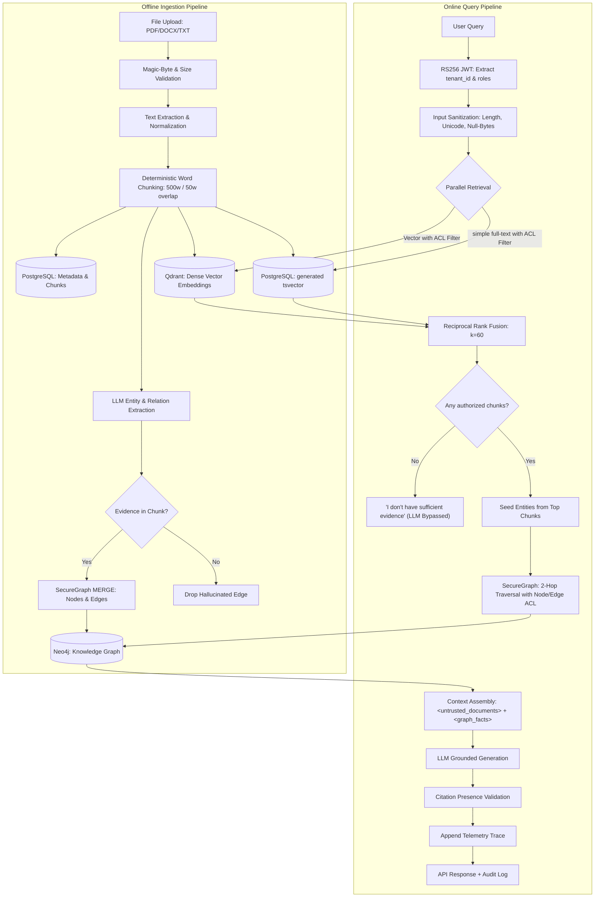

# GraphRAG — Multi-Tenant Hybrid RAG with Knowledge Graph

A demo-focused, multi-tenant GraphRAG application using **FastAPI + PostgreSQL + Qdrant + Neo4j**. The API can use managed cloud databases; browser users only need a website URL.

---

## 🚦 Project Status (Roadmap & Implementation Tracker)

| Component | Status | Implementation Details |
|---|:---:|---|
| **Browser Delivery** | ✅ Done | Static React site, same-origin `/api` proxy, Render and Vercel deployment templates |
| **Local Host Port Isolation** | ✅ Done | Backing database ports bound strictly to `127.0.0.1` to prevent LAN/WiFi exposure |
| **PostgreSQL Schemas & Storage** | ✅ Done | Tables for `users`, `documents`, `chunks`, and `audit_log` with relational constraints |
| **Ingestion Pipeline** | ✅ Done | Magic-byte verification (PDF/DOCX/TXT), 500-word overlap chunking, deterministic hashing |
| **Search Indexing** | ✅ Done | PostgreSQL `simple` full-text search + 384-dim Qdrant vectors; this is not BM25 |
| **Hallucinated Edge Verification** | ✅ Done | `evidence_in_chunk` validates that LLM relation evidence strictly exists in the source chunk before Neo4j write |
| **SecureGraph Gateway** | ✅ Done | Single authorized gate for all Cypher queries; no raw `session.run` permitted outside `SecureGraph` |
| **Hybrid Search & Fusion** | ✅ Done | ACL-filtered PostgreSQL full-text + Qdrant vector search + Reciprocal Rank Fusion (RRF, k=60) |
| **Low-memory Embeddings** | ✅ Done | FastEmbed / ONNX; cross-encoder reranking is disabled by default |
| **Query Trace Telemetry** | ✅ Done | Admin-only stage latencies and retrieval details returned in `query_trace` |
| **Prompt Injection Boundary** | ✅ Done | Raw chunk text escaped (`<` -> `&lt;`) and enclosed within `<untrusted_documents>` tags |
| **Citation Presence Check** | ✅ Done | Server-side regex validation identifying hallucinated chunk IDs not in context |
| **CI / CD Pipeline** | ✅ Done | GitHub Actions running Ruff, Bandit, pip-audit, Gitleaks, and Pytest |
| **Seed Demo Script** | ✅ Done | `scripts/seed_demo.py` seeds documents; local dev accounts come from `scripts/seed_dev_users.sql` |
| **Automated Semantic NLI Validation** | 🚧 Planned | Natural Language Inference (e.g. TruLens / Ragas) to prove semantic entailment of cited chunks |
| **Interactive UI Panel** | 🚧 Planned | Frontend widget rendering the "How did I get this answer?" expander and D3 graph visualizer |

---

## 1. System Architecture Diagram



---

## 2. "Kyun 3 Stores?" — Honest Engineering Rationale

> **Interviewer Question:** *"Why use PostgreSQL, Qdrant, and Neo4j for a prototype?"*
>
> **The honest answer:** PostgreSQL is the system of record and handles lexical search. The query uses `websearch_to_tsquery('simple', ...)` and `ts_rank_cd`; this is not BM25, so ranking differs. The `simple` configuration avoids English stemming for mixed-language text. Tenant and role ACLs remain in the SQL query. Qdrant stores dense vectors with ACL payloads, and Neo4j handles multi-hop graph traversal. The shared contract is `document_id`, `chunk_id`, `tenant_id`, and `allowed_roles`.

---

## 3. Threat Model & Security Matrix

| # | Threat Vector | Attacker Objective | Primary Defense | Defense-in-Depth / Secondary | Automated Verification Test |
|---|---|---|---|---|---|
| **T1** | **SQL / Cypher Injection** | Exfiltrate data or drop tables via crafted queries | **Parameterized queries** everywhere (`$1` in Postgres, `$param` in Cypher). No raw string interpolation. | Heuristic regex sanitizer blocks command payloads (`UNION SELECT`, `' OR 1=1 --`, `CALL db.*`). | `tests/test_security.py::TestInputValidation::test_cypher_injection_blocked` |
| **T2** | **Authorization Bypass** | Intern attempts to view Admin/Analyst confidential records | **Pre-filtering:** `tenant_id` and `allowed_roles` are pushed directly inside DB search queries and Neo4j paths. | Application-level `filter_accessible` safety net rejects leaks before context build. | `tests/test_security.py::TestACL::test_intern_cannot_access_confidential` |
| **T3** | **Prompt Injection / Tag Breakout** | Attacker uploads PDF with `</untrusted_documents>` to inject system instructions | Text brackets `<` and `>` are **escaped to `&lt;` and `&gt;`** before enclosing within `<untrusted_documents>`. | Explicit prompt rules instruct the LLM that document content is unexecutable data. | `tests/test_security.py::TestPromptInjection::test_prompt_tag_breakout_escaped` |
| **T4** | **Knowledge Graph Poisoning** | Attacker crafts document to force invalid entity labels (`HACKS`, `Malware`) into the graph | **Pydantic strict typing** with closed literal whitelist sets (`NodeType`, `RelType`). Extracted triples failing schema are dropped. | Deterministic entity IDs (`hash(tenant + name + type)`) prevent duplicate spoofing. | `tests/test_security.py::TestPromptInjection::test_extraction_schema_rejects_bad_rel_type` |
| **T5** | **Hallucinated Graph Edges** | LLM fabricates relationships between entities that do not exist in the source document | **`evidence_in_chunk` verification:** The exact sentence supporting the edge must exist verbatim in the source chunk. | Edges without source quotes are dropped before Neo4j write. | `tests/test_security.py::TestGraphIntegrityAndSecureGate::test_evidence_in_chunk_hallucinated_rejected` |
| **T6** | **Rogue Developer Cypher Leak** | Teammate writes a new endpoint with unauthenticated Cypher query | **`SecureGraph` Architecture Gate:** All Neo4j queries must pass through `SecureGraph`. | Static AST / file scan test asserts zero `session.run` calls outside `SecureGraph`. | `tests/test_security.py::TestGraphIntegrityAndSecureGate::test_no_raw_session_run_outside_secure_graph` |
| **T7** | **Hallucinated Citations** | LLM generates an answer citing fake chunk IDs not in context | **Citation Presence Verification:** Server compares all `[chunk_id]` citations against the retrieved chunk IDs. | Invalid citations are flagged and exposed in the JSON API response. | `tests/test_security.py::TestCitationValidation::test_hallucinated_citation_detected` |
| **T8** | **Database Exposure** | Publicly probe managed database endpoints | Keep provider API keys/passwords in server secrets; never expose database ports through the website proxy. | Use TLS URLs and provider access controls. | Deployment configuration review |

---

## 4. Query Trace Telemetry ("How Did I Get This Answer?")

Admin responses from `/api/v1/query` include a `query_trace` dictionary for evaluation and debugging; non-admin responses omit it:

```json
{
  "total_latency_ms": 138.4,
  "stages": {
    "input_validation": { "latency_ms": 0.3, "sanitized_length": 62 },
    "postgres_full_text": { "latency_ms": 14.1, "hits_count": 6, "top_chunk_ids": ["doc_apollo_c0", "doc_apollo_c1"] },
    "vector": { "latency_ms": 21.5, "hits_count": 8, "top_chunk_ids": ["doc_apollo_c0", "doc_vendor_c0"] },
    "rrf_fusion": { "latency_ms": 0.7, "fused_count": 11, "top_fused_ids": ["doc_apollo_c0", "doc_vendor_c0"] },
    "reranker": { "enabled": false, "method": "RRF-only", "selected_count": 5 },
    "relevance_gate": { "passed": true, "method": "RRF-only" },
    "graph_traversal": { "latency_ms": 18.2, "seed_entities_count": 3, "edges_count": 7 },
    "context_builder": { "latency_ms": 0.4, "context_chars": 2840 },
    "llm_generation": { "latency_ms": 50.2, "confidence": "high", "inference_used": false },
    "citation_validation": { "latency_ms": 0.3, "valid_count": 2, "invalid_count": 0, "invalid_citations": [] }
  }
}
```

The low-memory deployment uses RRF without a cross-encoder. It abstains when retrieval returns no authorized chunks. PostgreSQL `ts_rank_cd` is not BM25; measure that ranking change in the evaluation report. FastEmbed model changes require a new Qdrant collection and re-ingestion even when dimensions match.

---

## 5. Quick Start & Demo Setup

### Browser-only user experience

End users open the website URL. FastAPI, PostgreSQL, Qdrant, and Neo4j run as hosted services; users do not install Docker, Node, or databases. For local development, Docker Compose starts the same stack, including an Nginx frontend at `http://localhost:8080`.

### Managed cloud setup

1. Create managed PostgreSQL, Qdrant Cloud, and Neo4j Aura instances. Free quotas, suspension policies, and prices change; review the [Neon pricing page](https://neon.com/pricing), [Qdrant Cloud pricing](https://qdrant.tech/pricing/), [Neo4j Aura pricing](https://neo4j.com/pricing/), [Render pricing](https://render.com/pricing), and [Vercel pricing](https://vercel.com/pricing) before signing up.
2. Run `scripts/init_postgres.sql` in the managed PostgreSQL SQL editor, then run every file in `scripts/migrations/` in filename order. Set the Neon connection URL with `sslmode=require`.
3. Add the database URLs/passwords, Qdrant API key, LLM key, and fresh RS256 key contents as secret environment variables in Render. `render.yaml` defines the API service and uses `/api/v1/health/live` for its non-database liveness check. The API binds to `0.0.0.0:$PORT`.
4. Import the repository into Vercel with `frontend/` as the project root. In `frontend/vercel.json`, replace `YOUR-API.onrender.com` with the deployed API hostname. The rewrite proxies `/api/*` through the website origin so the browser uses same-site HttpOnly cookies.
5. Provision production accounts from a trusted operator machine with `python scripts/create_user.py --username NAME --email EMAIL --tenant-id TENANT --role admin`. It prompts for a password and stores only a scrypt hash. Roles are assigned by the operator; public self-signup is not enabled.
6. Re-ingest documents after switching to the multilingual FastEmbed model. The new Qdrant collection is `chunks_multilingual_minilm_l12_v1` (384 dimensions). Only extracted text/chunks are kept in PostgreSQL; original uploaded files remain in memory during processing and are not written to ephemeral disk.
7. Run `pytest tests/` and the cross-tenant security suite before sharing the deployment. Compare retrieval quality with the previous BM25 + cross-encoder setup; current Postgres full-text ranking is not BM25, and the reranker is disabled.

For local UI development, run `npm install` and `npm run dev` in `frontend/`; Vite proxies `/api/v1` to `http://127.0.0.1:8000`. The local API still needs the managed services or the Docker Compose development stack online.

The free service tiers are for a small demo, not an uptime or data-retention promise. Keep backup copies, monitor each provider's current limits, and expect sleeping services/cold starts where the provider documents them.

---

## 6. Running Tests & CI

### Run Pytest Test Suite
```bash
pip install -r requirements-dev.txt
pytest tests/ -v
```

### Run Static Security Scan
```bash
bandit -r app/ -ll -ii
```

### Run Linting
```bash
ruff check .
```
