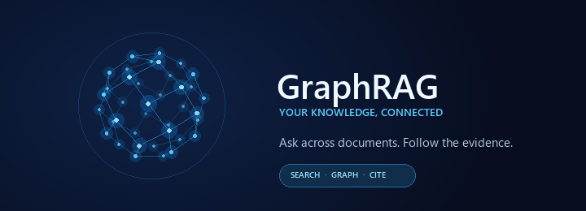

<div align="center">



### Ask your documents. Follow the evidence.

**A browser-based GraphRAG workspace** with secure document search, citations, and connected knowledge.

</div>

---

## ✨ What it does

- Upload PDF, DOCX, and TXT documents and track indexing status.
- Ask questions and get grounded answers with clickable source chunks.
- Explore graph connections and send 👍 / 👎 feedback.
- Keep document search scoped by workspace, tenant, and user role.

**Stack:** React + Vite · FastAPI · PostgreSQL · Qdrant · Neo4j · FastEmbed

## 🚀 Run a local demo

Docker Desktop must be installed and running. In PowerShell:

```powershell
cd D:\DOWNLOAD\GraphRAG
python scripts\generate_keys.py
Copy-Item .env.example .env
docker compose up --build
```

Then open **http://localhost:8080**. Keep the terminal open; the first startup may take a while as services and the embedding model initialize.

Development sign-in: `admin` / `adminpass`  
These demo credentials are for local development only.

> If PowerShell says **“docker is not recognized”**, Docker Desktop is not installed or is not running. The command cannot work until Docker is available.

## 🌐 Use it without Docker

For a browser-only website, deploy the API to **Render**, the frontend to **Vercel**, and connect managed **PostgreSQL, Qdrant, and Neo4j** services. Run `scripts/init_postgres.sql` and the migrations in `scripts/migrations/` in filename order. Set the database, LLM, and JWT secrets in Render, then replace `YOUR-API.onrender.com` in `frontend/vercel.json` with your API hostname.

After deployment, users open the Vercel URL in a browser—no local installs. Create production accounts with `scripts/create_user.py`; public signup is disabled.

## 🔐 Security basics

HttpOnly session cookies · CSRF checks · role-filtered retrieval · protected citation source access · admin-only query traces · secret keys kept server-side.

## 🧪 Verify

```powershell
python -m pytest tests/ -q
cd frontend
npm run build
```

**Current demo scope:** answers are not streamed; chat history and the full admin console are not included yet.

